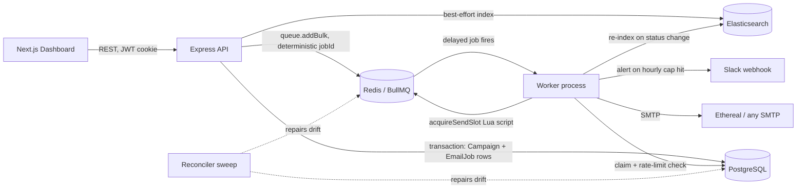

# ReachInbox Email Scheduler

A full-stack email job scheduler: schedule a single email or a CSV-driven campaign to send at a
future time, with an hourly per-sender rate limit that nothing ever violates and nothing ever
gets dropped for hitting. Built on **BullMQ delayed jobs** (not cron), **PostgreSQL** as the
source of truth, and a **Next.js** dashboard. Sends go to **Ethereal Email** — nothing real is
delivered, but the send path (SMTP, retries, bounces-as-errors) is real.

The single property this system is built around: **an email is sent exactly once, at
approximately the right time — even across a crash, a restart, multiple workers, or a wiped
Redis.** Everything else (rate limiting, Slack alerts, search) is built on top of that guarantee,
never at the expense of it.

## Demo video

`<link to be added>`

## Screenshots

| Dashboard | Compose | Bull Board | Slack alert |
| --- | --- | --- | --- |
| `<screenshot>` | `<screenshot>` | `<screenshot>` | `<screenshot>` |

## Tech stack

| Layer | Choice | Why |
| --- | --- | --- |
| Scheduling | BullMQ (Redis-backed) | Delayed jobs are durable Redis sorted-set entries, not an in-process timer — they survive a process restart for free. The assignment explicitly rules out cron. |
| Queue backend | Redis (`ioredis`), AOF-enabled | BullMQ requires Redis; AOF persistence means the queue survives a *container* restart, not just a process restart. |
| Database | PostgreSQL + Prisma | Relational integrity for campaigns/jobs, transactional multi-row inserts, and a schema a reviewer can open and read. Prisma gives typed queries and migrations. |
| Email delivery | Nodemailer → Ethereal Email | A real SMTP send path with zero risk of mailing a real address; every send gets a clickable preview link. |
| Search | Elasticsearch, with Postgres fallback | Full-text search over recipient/subject/body across large campaigns; degrades to `ILIKE` instead of taking the app down if ES is unreachable. |
| Queue UI | `@bull-board/express` | A live, zero-effort view into delayed/active/failed jobs — useful for the demo and for debugging. |
| Validation | Zod | Same validation library on env config and every request body; parse errors are readable, not stack traces. |
| Logging | Pino | Structured JSON logs; every line in a job's lifecycle carries `emailJobId`/`campaignId`/`bullJobId`. |
| Tests | Vitest | Fast, native ESM/TS support, shared config style with the rest of the stack. |
| Frontend | Next.js (App Router) + TypeScript | File-based routing, server/client component split, fast dev loop. |
| Server state | TanStack Query | Polling with `refetchInterval`, cache invalidation on mutation, pause-when-hidden — all built in. |
| Styling | Tailwind CSS | Utility classes match the small, consistent design-token set this UI uses without a separate CSS layer. |
| CSV parsing | PapaParse | Robust delimiter/quote handling for arbitrary user-uploaded CSVs, done client-side before anything is sent to the server. |

## Quick start

```bash
# 1. Infrastructure
docker compose up -d
docker compose ps   # wait for all three services to report healthy

# 2. Backend
cd backend
cp .env.example .env
# edit .env: set GOOGLE_CLIENT_ID (see "Google OAuth setup"), and generate secrets:
node -e "console.log(require('crypto').randomBytes(48).toString('base64'))"   # -> JWT_SECRET
node -e "console.log(require('crypto').randomBytes(32).toString('base64'))"   # -> ENCRYPTION_KEY
npm install
npm run db:migrate      # applies prisma/migrations
npm run db:seed -- you@gmail.com   # creates 2 Ethereal senders for your Google account
npm run dev              # runs API (:4000) + worker, via concurrently

# 3. Frontend (new terminal)
cd frontend
cp .env.example .env.local
# edit .env.local: set NEXT_PUBLIC_GOOGLE_CLIENT_ID (same client ID as backend)
npm install
npm run dev               # :3000
```

Open `http://localhost:3000`, sign in with the Google account you seeded, and compose a
campaign. Bull Board is at `http://localhost:4000/admin/queues` (basic auth from
`BULL_BOARD_USER`/`BULL_BOARD_PASSWORD`).

## Running the backend — and why API and worker are separate processes

```bash
npm run dev:api      # Express API only
npm run dev:worker   # BullMQ worker only
npm run dev          # both, via concurrently (what you normally want)
```

`src/index.ts` (API) and `src/worker.ts` (worker) are two independent Node processes sharing one
Postgres database and one Redis instance. This is not incidental:

- **Horizontal scaling.** Run more worker processes to raise throughput without touching the
  API. The Redis Lua rate limiter and the Postgres claim guard are what make that safe — workers
  never need to coordinate directly with each other.
- **Unambiguous restart demo.** Kill *only* the worker mid-campaign: the API keeps accepting
  requests, BullMQ keeps holding the delayed jobs in Redis, and nothing is lost. Restart the
  worker and sending resumes exactly where it left off, with no duplicates. If API and worker
  shared a process, "restart" would always restart scheduling too, which proves a weaker claim.
- **Independent failure domains.** A bug that crashes the worker (e.g. a bad SMTP config) doesn't
  take the API/dashboard down, and vice versa.

Both processes install `SIGTERM`/`SIGINT` handlers: the API stops accepting new connections and
lets in-flight requests finish; the worker calls `worker.close()`, which stops pulling new jobs
and waits for active ones to finish before exiting (`src/index.ts`, `src/worker.ts`).

## Running the frontend

```bash
cd frontend
npm run dev          # http://localhost:3000
npm run build && npm run start   # production build
npm run typecheck
npm run test
```

The frontend only needs the backend reachable at `NEXT_PUBLIC_API_URL` and the same Google OAuth
client ID as the backend.

## Ethereal Email setup

[Ethereal](https://ethereal.email) is a fake SMTP service made for exactly this: it accepts and
stores mail without delivering it anywhere, and gives you a web inbox + a per-message preview
link. No account or signup is needed — the app creates mailboxes for you.

1. **Seed script (fastest):** `npm run db:seed -- you@gmail.com 2` creates 2 Ethereal mailboxes
   as senders for that user and prints each one's Ethereal web-inbox login to the terminal.
2. **From the dashboard:** the "Add sender" flow has a one-click **"Use Ethereal"** button
   (`POST /api/senders/ethereal`) that provisions a brand-new mailbox on the spot — no credentials
   to type in.
3. **Your own SMTP creds:** `POST /api/senders` also accepts any real SMTP host/port/user/pass
   (e.g. a real Ethereal account you created manually, or Mailtrap); the password is
   AES-256-GCM-encrypted before it touches Postgres (`src/lib/crypto.ts`) and verified with a live
   `transport.verify()` call before the sender is saved.
4. **Where previews show up:** every sent row in the dashboard's **Sent** table has a **Preview**
   link — `nodemailer.getTestMessageUrl()` from the send result, stored on `EmailJob.previewUrl`.
   Click it to open the actual rendered email in Ethereal's viewer.
5. Multiple senders rotate round-robin across a campaign's recipients (see Architecture →
   scheduling).

## Environment variables

### Backend (`backend/.env`, see `backend/.env.example`)

| Variable | Default | Required | Description |
| --- | --- | --- | --- |
| `NODE_ENV` | `development` | no | `development` \| `test` \| `production`. |
| `PORT` | `4000` | no | API port. |
| `LOG_LEVEL` | `info` | no | Pino level. |
| `DATABASE_URL` | — | **yes** | Postgres connection string. |
| `REDIS_URL` | `redis://localhost:6379` | no | Redis connection string (BullMQ + rate limiter + dedupe keys). |
| `ELASTICSEARCH_URL` | `http://localhost:9200` | no | ES node URL. |
| `ELASTICSEARCH_INDEX` | `emails` | no | Index name. |
| `FRONTEND_URL` | `http://localhost:3000` | no | CORS origin + OAuth redirect base. |
| `API_PUBLIC_URL` | `http://localhost:4000` | no | This API's own externally reachable URL. |
| `JWT_SECRET` | — | **yes** (≥32 chars) | Signs session cookies and the Slack OAuth `state`. |
| `SESSION_TTL_HOURS` | `168` | no | Session cookie lifetime. |
| `ENCRYPTION_KEY` | — | **yes** (32 bytes, base64) | AES-256-GCM key for SMTP passwords + Slack webhook URLs at rest. |
| `GOOGLE_CLIENT_ID` | — | **yes** | Google OAuth 2.0 Web client ID; verifies the ID token from the frontend. |
| `SLACK_CLIENT_ID` | — | no | Blank ⇒ Slack integration reports "not configured" and no-ops. |
| `SLACK_CLIENT_SECRET` | — | no | ″ |
| `SLACK_REDIRECT_URI` | — | no | Must exactly match a Redirect URL registered in the Slack app. |
| `BULL_BOARD_USER` | `admin` | no | Basic-auth user for `/admin/queues`. |
| `BULL_BOARD_PASSWORD` | — | **yes** (≥8 chars) | Basic-auth password for `/admin/queues`. |
| `QUEUE_NAME` | `email-send` | no | BullMQ queue name. |
| `WORKER_CONCURRENCY` | `5` | no | Jobs processed in parallel, per worker process. |
| `QUEUE_GLOBAL_RATE_MAX` / `QUEUE_GLOBAL_RATE_DURATION_MS` | `50` / `1000` | no | Coarse BullMQ `limiter` shared by every worker process — a backstop above the per-sender Redis limiter. |
| `JOB_ATTEMPTS` | `3` | no | SMTP-failure retries, exponential backoff from `JOB_BACKOFF_MS`. |
| `JOB_BACKOFF_MS` | `5000` | no | Backoff base. |
| `REMOVE_ON_COMPLETE_AGE_S` / `REMOVE_ON_FAIL_AGE_S` | `86400` / `604800` | no | How long finished BullMQ jobs stay in Redis (Postgres keeps the permanent record regardless). |
| `ENQUEUE_CHUNK_SIZE` | `500` | no | Batch size for `queue.addBulk()` on large campaigns. |
| `MAX_EMAILS_PER_HOUR` | `200` | no | Global default hourly cap per sender (lowest precedence). |
| `MAX_EMAILS_PER_HOUR_PER_SENDER` | — | no | Overrides the above for all senders that don't set their own `hourlyLimit`. |
| `MIN_DELAY_BETWEEN_EMAILS_MS` | `2000` | no | Minimum gap between two sends from the same sender. |
| `RECONCILE_INTERVAL_MS` | `300000` | no | How often the reconciliation sweep runs (safety net — see Architecture). |
| `STALE_CLAIM_MS` | `120000` | no | A worker's `PROCESSING` claim older than this with no live BullMQ job is treated as abandoned. |

### Frontend (`frontend/.env.local`, see `frontend/.env.example`)

| Variable | Required | Description |
| --- | --- | --- |
| `NEXT_PUBLIC_API_URL` | no (default `http://localhost:4000`) | Backend base URL. Public — embedded in the browser bundle. |
| `NEXT_PUBLIC_GOOGLE_CLIENT_ID` | **yes** | Same OAuth client ID as the backend's `GOOGLE_CLIENT_ID`. |

## Google OAuth setup

1. [Google Cloud Console](https://console.cloud.google.com/) → create/select a project →
   **APIs & Services → OAuth consent screen** → External, add your own email as a test user.
2. **APIs & Services → Credentials → Create Credentials → OAuth client ID** → Application type
   **Web application**.
3. **Authorized JavaScript origins:** `http://localhost:3000`
4. **Authorized redirect URIs:** none needed — `@react-oauth/google`'s `GoogleLogin` button uses
   the implicit/credential flow in the browser, not a server redirect.
5. Copy the **Client ID** into both `backend/.env` (`GOOGLE_CLIENT_ID`) and
   `frontend/.env.local` (`NEXT_PUBLIC_GOOGLE_CLIENT_ID`) — it is the same value in both places.
6. Sign in on `http://localhost:3000`. The frontend sends the Google ID token to
   `POST /api/auth/google`; the backend verifies it against `GOOGLE_CLIENT_ID` with
   `google-auth-library`, upserts the `User` row, and sets an httpOnly session cookie. No mock
   auth path exists.

## Slack app setup

1. [api.slack.com/apps](https://api.slack.com/apps) → **Create New App → From scratch**.
2. **OAuth & Permissions** → scroll to **Redirect URLs** → add
   `https://<your-tunnel-or-host>/api/slack/callback` (Slack requires HTTPS; use `ngrok`/a
   tunnel for local dev, or your real domain in production).
3. Still on **OAuth & Permissions**, under **Scopes**, no bot scopes are needed — this
   integration uses the legacy **`incoming-webhook`** scope ("Add to Slack" style), which lets a
   user pick a destination channel during install and hands back a single-channel webhook URL.
   Request it under **OAuth & Permissions → Scopes → Bot Token Scopes → `incoming-webhook`** (or
   enable **Incoming Webhooks** under **Features** and let the app request it on install).
4. Copy the app's **Client ID** and **Client Secret** from **Basic Information** into
   `backend/.env` as `SLACK_CLIENT_ID` / `SLACK_CLIENT_SECRET`, and set `SLACK_REDIRECT_URI` to
   the exact URL registered in step 2.
5. From the dashboard, click **Connect Slack** → approve → you're redirected back with
   `?slack=connected`. A rate-limit alert now posts to the channel you picked, the moment any
   sender's hourly cap is hit.
6. Leaving the three `SLACK_*` variables blank is fully supported: `GET /api/slack/status`
   reports `configured: false`, the dashboard shows a disabled "Slack not configured" state, and
   every alert call silently no-ops — sending is never affected either way.

## Architecture overview



### How scheduling works

1. `POST /api/campaigns` validates the request (Zod), normalises/dedupes/validates recipient
   addresses, and rejects a `startAt` in the past.
2. The **hour-window planner** (`src/queue/scheduler.ts`) decides *every* recipient's sender and
   `scheduledAt` up front, in one pass: senders are assigned round-robin, each recipient's
   earliest possible time is `startAt + k × delayBetweenMs`, and if a sender's UTC hour window is
   already full (accounting for load already committed by other campaigns on that sender), the
   slot is pushed to the next hour window — keeping the requested pacing instead of bunching up.
3. The `Campaign` row and all `EmailJob` rows (status `SCHEDULED`) are created in **one Postgres
   transaction**, so a crash mid-creation never leaves a half-created campaign.
4. After commit, every job is enqueued to BullMQ with `delay = scheduledAt - now` and a
   **deterministic `jobId = EmailJob.id`** (`src/queue/emailQueue.ts`), using `queue.addBulk()` in
   chunks of `ENQUEUE_CHUNK_SIZE` so a 1000+-recipient campaign doesn't block the event loop.
   BullMQ refuses a duplicate job ID — free, structural deduplication.
5. Jobs are indexed into Elasticsearch in the background.

**Why plan ahead instead of discovering the limit at send time:** if 1000 jobs were all scheduled
for `startAt` and only then checked against a 200/hour cap, 800 of them would wake up at the top
of the hour just to be told "not yet" and re-delayed — repeatedly, as the cap keeps being hit.
Planning the hour windows at creation time means the *common case* (one campaign, no contention)
produces a schedule that is already compliant, and jobs fire once, at the time they're actually
meant to send. The runtime Redis limiter below still runs on every send — it's the safety net for
the case the planner can't see (two campaigns created at the same instant, racing for the same
sender), not the primary mechanism.

### How restart persistence works — three layers

1. **Redis/BullMQ durability.** Delayed jobs live in a Redis sorted set keyed by their fire time;
   that data survives any API/worker process restart natively. `docker-compose.yml` additionally
   runs Redis with `--appendonly yes --appendfsync everysec`, so the *data* survives a Redis
   container restart too — not just the processes talking to it.
2. **Postgres as the source of truth.** Every `EmailJob`'s intended state (`status`,
   `scheduledAt`, `senderId`, …) is a durable row independent of whatever BullMQ currently thinks.
   Redis holds timers; Postgres holds truth.
3. **The reconciler — a safety net, never the scheduler** (`src/services/reconciler.ts`). On
   worker boot, and then every `RECONCILE_INTERVAL_MS`, it sweeps Postgres for every
   `SCHEDULED`/`QUEUED`/`RATE_LIMITED` row and checks whether a live BullMQ job exists for it. A
   missing one is re-enqueued (past-due ones fire immediately); because job IDs are deterministic,
   re-adding one that *does* exist is a harmless no-op. It also recovers `PROCESSING` rows
   abandoned by a worker that died mid-job: if the row never reached the SMTP handoff
   (`sendStartedAt` is null) it's safely returned to the queue; if it did reach SMTP, the outcome
   is genuinely unknown, so it is finalized from a Redis "sent marker" if one exists, or marked
   `FAILED` — **never blindly retried**, because retrying an ambiguous send risks a duplicate. This
   is what makes the system survive **total Redis data loss**, not just a process crash — demoed
   by flushing Redis entirely and watching the next sweep rebuild every pending job from Postgres
   alone. It runs on a `BullMQ` job scheduler with `setGlobalConcurrency(1)`, so N worker
   processes still run exactly one sweep per interval, not N.

The one `setInterval`-shaped thing in this codebase is that sweep, and it is explicitly not a
scheduling mechanism — no email's send time is ever decided by it; it only repairs drift between
two already-authoritative stores.

### How rate limiting and concurrency work

Enforced atomically in Redis via a single Lua script, because a naive `GET` → `if < limit` →
`INCR` from Node has a race window: with N workers polling concurrently, all N can read the same
"199" and all decide to send, overshooting the cap by up to N. Running the read-compare-increment
*inside* Redis means there is no interleaving — exactly `limit` callers can ever win.

```lua
-- KEYS[1] hour-window counter   KEYS[2] last-send timestamp
-- ARGV[1] limit  ARGV[2] now(ms)  ARGV[3] window end(ms)  ARGV[4] min spacing(ms)  ARGV[5] counter TTL(s)
local limit      = tonumber(ARGV[1])
local now        = tonumber(ARGV[2])
local windowEnd  = tonumber(ARGV[3])
local minSpacing = tonumber(ARGV[4])

local count = tonumber(redis.call('GET', KEYS[1]) or '0')
if count >= limit then
  return {0, windowEnd - now, count}            -- 0 = hourly limit reached
end

local last = tonumber(redis.call('GET', KEYS[2]) or '0')
local wait = last + minSpacing - now
if wait > 0 then
  return {2, wait, count}                        -- 2 = too soon after previous send
end

count = redis.call('INCR', KEYS[1])
if count == 1 then
  redis.call('EXPIRE', KEYS[1], tonumber(ARGV[5]))
end
redis.call('SET', KEYS[2], now, 'PX', math.max(minSpacing, 1000) * 2)
return {1, 0, count}                             -- 1 = allowed, slot reserved
```

Two rules, one atomic round-trip (`src/services/rateLimiter.ts`):

- **Hourly cap**, keyed `ratelimit:sender:{senderId}:{YYYY-MM-DDTHH}` (fixed UTC hour window).
  Cap precedence: `Sender.hourlyLimit` → `MAX_EMAILS_PER_HOUR_PER_SENDER` →
  `MAX_EMAILS_PER_HOUR`; a campaign's own `hourlyLimit` can additionally *tighten* (never raise)
  the effective cap for jobs from that campaign (`src/services/limits.ts`).
- **Minimum spacing** between two sends from the same sender, keyed
  `ratelimit:sender:{senderId}:last`.

**Never drop, always reschedule.** When the worker's `acquireSendSlot()` call returns "hourly
limit reached," the job is *not* failed — its `EmailJob` row moves to `RATE_LIMITED`, is
rescheduled to just after the next hour window opens (preserving relative order via a small
`sequenceIndex` offset), and the BullMQ job is re-delayed to that time (`DelayedError`, no retry
attempt consumed). Hitting "too soon after the last send" re-delays by the remaining gap, no
status change needed.

Concurrency has two independent layers: `WORKER_CONCURRENCY` jobs run in parallel *within* one
worker process, and BullMQ's own `limiter: { max, duration }` option is a coarse global throttle
*across every worker process* sharing the queue — a backstop above the per-sender Lua limiter,
not a replacement for it.

**Honest trade-off:** a fixed hour window is simpler than a sliding log or token bucket, but
allows a burst of up to ~2× the limit across two adjacent windows in the worst case (e.g. 200
sent in the last second of 2–3pm, another 200 in the first second of 3–4pm). A sliding-window or
token-bucket limiter would smooth this at the cost of more Redis state and a more complex Lua
script. Fixed windows were chosen because the assignment specifies an *hourly* cap, which maps
directly onto UTC clock-hour windows — and because the planner above schedules proactively around
those same windows, so in practice the burst scenario only arises from genuinely concurrent,
uncoordinated campaigns, which is exactly the case the Slack alert and `RATE_LIMITED` status exist
to surface.

### How idempotency is guaranteed — three independent layers

No single layer below is sufficient alone; together they cover every place a duplicate send could
otherwise sneak in.

1. **Deterministic BullMQ job ID** (`jobId = EmailJob.id`). If the same email is ever enqueued
   twice — a retried API request, the reconciler re-adding a job that already exists — BullMQ
   simply refuses the duplicate. This guards against *double scheduling*.
2. **Conditional SQL claim** (`src/services/delivery.ts`, used from
   `src/workers/emailWorker.ts`). Before doing anything, a worker runs
   `UPDATE email_jobs SET status='PROCESSING', claimToken=$token WHERE id=$1 AND status IN
   ('SCHEDULED','QUEUED','RATE_LIMITED')`. If zero rows are affected, another worker (or a
   stalled-job re-run of the *same* worker) already claimed or finished it — this attempt returns
   immediately without touching SMTP. This guards against *two workers racing the same job*, which
   job-ID dedup alone does not prevent once a job is already in the queue exactly once.
3. **Redis "sent marker"** (`writeSentMarker`/`readSentMarker` in `src/services/delivery.ts`).
   Written *immediately after* a successful SMTP send, before the Postgres row is updated. If the
   process crashes between the SMTP success and the Postgres write, the row is left `PROCESSING`
   — but the marker is already in Redis, so the next time this job is touched (a BullMQ stalled-
   job retry, or the reconciler recovering an abandoned claim) it is finalized as `SENT` from the
   marker instead of being re-sent. This guards against the single most dangerous window: *the
   email already left SMTP but our own bookkeeping doesn't know it yet.*

If the send fails or the process dies **before** reaching SMTP (`sendStartedAt` is still null),
the row is safe to return to `QUEUED`/retry — nothing was sent. If it dies **after** the SMTP
handoff with no marker recoverable, the outcome is genuinely unknown and the job is marked
`FAILED` with an explicit note rather than retried — guaranteeing no duplicate at the cost of, in
that one rare case, a possible non-delivery the user can see and re-send manually.

### Behavior under load — a concrete walk-through

Run `npm run load:seed -- --email you@gmail.com --count 1000 --limit 200` (2 active senders,
200/hour each ⇒ 400/hour combined):

- The planner round-robins the 1000 recipients across the 2 senders (500 each) and, since 500 >
  200, pushes each sender's overflow into later hour windows: sender A gets 200 in hour 0, 200 in
  hour 1, 100 in hour 2; sender B the same. `deferredByCap` in the campaign's plan reports exactly
  how many of the 1000 were pushed past their "naive" slot.
- As each hour window opens, the worker sends up to 200 per sender before the Lua limiter starts
  returning "hourly limit reached" for that sender — which does not happen here, because the plan
  already respects the cap. Nothing is deferred *again* at send time; the runtime limiter is
  idle overhead on the happy path.
- Run the same command with `--parallel 2` (two campaigns created at the same instant, each
  planned from an independent snapshot of sender load): the two plans *together* overbook the
  current window on purpose. The Lua limiter catches exactly the overflow the planner couldn't
  see — those jobs flip to `RATE_LIMITED`, get rescheduled into the next window, and exactly one
  Slack alert fires per sender per window (deduped via `slack:alerted:{senderId}:{window}`), even
  though hundreds of jobs were deferred.
- Throughout, `WORKER_CONCURRENCY=5` jobs are in flight at once per worker process, and
  `QUEUE_GLOBAL_RATE_MAX=50`/`QUEUE_GLOBAL_RATE_DURATION_MS=1000` caps total SMTP attempts across
  all workers to 50/second, regardless of how many senders or campaigns are active.

### Graceful degradation

- **Elasticsearch down:** `searchEmails()` catches the ES error and transparently falls back to
  a Postgres `ILIKE` query (`src/services/search.ts`); the API response shape is identical, with
  `source: 'postgres'` instead of `'elasticsearch'`. Indexing failures are logged and swallowed,
  never thrown into the send path.
- **Slack absent or erroring:** every alert call is wrapped in try/catch and fires
  fire-and-forget from the worker; a failure (timeout, 404'd webhook) is logged and the dedupe key
  is released so a later hit in the same window can retry — sending is never blocked or delayed by
  it.
- **SMTP failure:** BullMQ retries up to `JOB_ATTEMPTS` with exponential backoff
  (`JOB_BACKOFF_MS`); a permanent SMTP 5xx is detected and thrown as `UnrecoverableError` to skip
  pointless retries. Only after the final attempt is the row marked `FAILED`, with the exact SMTP
  error stored on `lastError`.
- **`/health`** checks Postgres, Redis, Elasticsearch and SMTP independently, each with its own
  latency and status; Postgres/Redis down ⇒ `503`, Elasticsearch/SMTP down ⇒ `200` with
  `status: "degraded"` — because the app keeps functioning (minus search quality / minus new
  sends) rather than being "down."

## Features implemented

### Backend

| Requirement | Status | How |
| --- | --- | --- |
| No cron scheduling | ✅ | BullMQ delayed jobs only; the reconciler sweep is a documented, explicit exception (safety net, not scheduler). |
| Survives restarts | ✅ | Redis AOF + Postgres source of truth + reconciler (`src/services/reconciler.ts`). |
| Idempotent delivery | ✅ | Deterministic job ID + conditional SQL claim + Redis sent-marker (`src/services/delivery.ts`, `src/workers/emailWorker.ts`). |
| Configurable limits, no hardcoding | ✅ | All limits/delays are env vars validated in `src/config/env.ts`. |
| Rate-limit state outside process memory | ✅ | Redis Lua script (`src/services/rateLimiter.ts`); correct across N worker processes. |
| Never drop on rate limit | ✅ | `RATE_LIMITED` status + reschedule into next window, order preserved (`src/workers/emailWorker.ts`). |
| Real Google OAuth | ✅ | `google-auth-library` ID token verification, httpOnly JWT session cookie (`src/services/auth.ts`, `src/routes/auth.ts`). |
| Real Slack OAuth + live alert | ✅ | OAuth v2 `incoming-webhook` flow + deduplicated Block Kit alert (`src/services/slack.ts`). |
| CSV/batch scheduling | ✅ | Transactional multi-row create + chunked `addBulk` (`src/services/campaigns.ts`, `src/queue/emailQueue.ts`). |
| Hour-window pre-planning | ✅ | `src/queue/scheduler.ts`, tested in `tests/scheduler.test.ts`. |
| Search | ✅ | Elasticsearch with Postgres fallback (`src/services/search.ts`). |
| Health check | ✅ | Per-dependency status + latency (`src/routes/health.ts`). |
| Load test script | ✅ | `backend/scripts/seed-load.ts`. |
| Tests | ✅ | Rate limiter concurrency, planner, idempotency/claim guard, reconciler, Slack dedupe (`backend/tests/`). |
| Structured logs with correlation IDs | ✅ | Pino child logger per job (`emailJobId`/`campaignId`/`bullJobId`), `pino-http` per request. |
| Graceful shutdown | ✅ | `SIGTERM`/`SIGINT` handlers in `src/index.ts` and `src/worker.ts`. |

### Frontend

| Requirement | Status | How |
| --- | --- | --- |
| Google sign-in | ✅ | `@react-oauth/google`, httpOnly cookie session (`src/app/page.tsx`, `src/hooks/useAuth.ts`). |
| Dashboard shell | ✅ | Header, Slack pill, user menu, stat cards, URL-synced tabs (`src/app/dashboard/Dashboard.tsx`). |
| Live quota meter | ✅ | `GET /api/emails/stats` reads the limiter's own Redis keys (`src/components/dashboard/StatCards.tsx`). |
| Compose with CSV upload | ✅ | Drag/drop + PapaParse, valid/invalid/duplicate counts (`src/components/email/ComposeModal.tsx`, `src/lib/recipients.ts`). |
| Live schedule preview | ✅ | Client-side mirror of the server planner (`src/lib/schedulePreview.ts`). |
| Scheduled/Sent tables | ✅ | One generic `DataTable` with per-view column configs, pagination, skeletons, empty states (`src/components/ui/DataTable.tsx`, `src/components/email/EmailTables.tsx`). |
| Search | ✅ | Debounced, wired to `/api/search` (`src/components/email/SearchBar.tsx`). |
| Slack connect UI | ✅ | Pill + connect/disconnect (`src/components/layout/SlackPill.tsx`). |
| Bull Board link | ✅ | Linked from the header. |
| Typed API client, no `any` | ✅ | `src/lib/api.ts`, `src/types/api.ts` mirrors backend response shapes. |

## API reference

Every response is `{ success, data? } | { success: false, error }`.

```
POST   /api/auth/google          { credential } -> { user }
GET    /api/auth/me              -> { user }
POST   /api/auth/logout          -> { loggedOut }

GET    /api/senders              -> Sender[]
POST   /api/senders              { label, smtpHost, smtpPort, smtpSecure, smtpUser, smtpPass, fromAddress, hourlyLimit? } -> Sender
POST   /api/senders/ethereal     { hourlyLimit? } -> Sender & { etherealLogin }

POST   /api/campaigns            { subject, body, recipients[], startAt, delayBetweenMs, hourlyLimit?, senderIds[] } -> { campaign, plan }
GET    /api/campaigns            ?page&limit -> { items, page, limit, total }
GET    /api/campaigns/:id        -> Campaign & { counts }
DELETE /api/campaigns/:id        -> cancels every still-pending EmailJob

GET    /api/emails/scheduled     ?page&limit -> { items, page, limit, total }
GET    /api/emails/sent          ?page&limit -> { items, page, limit, total }
POST   /api/emails/:id/cancel    -> cancels one EmailJob
GET    /api/emails/stats         ?since -> { scheduled, sentToday, failed, rateLimited, currentHour }

GET    /api/search               ?q&status&from&to&page&limit -> { items, page, limit, total, source }
GET    /api/config               -> { minDelayBetweenEmailsMs, defaultHourlyLimit, maxRecipients, bullBoardPath }

GET    /api/slack/install        -> 302 to Slack consent
GET    /api/slack/callback       -> 302 back to the dashboard
GET    /api/slack/status         -> { configured, connected, teamName, channelName, connectedAt }
POST   /api/slack/disconnect     -> { connected: false }
POST   /api/slack/test           -> posts a test message to the connected channel

GET    /health                   -> { status, uptimeS, checks: { postgres, redis, elasticsearch, smtp }, queue }
GET    /admin/queues             -> Bull Board (HTTP basic auth)
```

## Testing

```bash
cd backend && npm run test        # vitest run
cd frontend && npm run test
```

Covered, deliberately kept small and targeted rather than broad and shallow:

- `tests/rateLimiter.test.ts` — the Lua limiter under concurrent access (N parallel callers never
  exceed the cap), min-spacing enforcement, window rollover.
- `tests/scheduler.test.ts` — the hour-window planner: round-robin assignment, overflow into the
  next window, respecting pre-existing load.
- `tests/worker.integration.test.ts` — the claim guard rejects a second concurrent claim, a
  `RATE_LIMITED` job is deferred not dropped, permanent vs. retryable SMTP failures.
- `tests/reconciler.integration.test.ts` — missing BullMQ jobs are rebuilt from Postgres, stale
  `PROCESSING` claims are recovered or correctly marked ambiguous.
- `tests/slack.integration.test.ts` — one alert per sender per hour window, not one per deferred
  job.
- `frontend/src/lib/recipients.test.ts` — CSV/TXT parsing: header detection, headerless
  single-column files, duplicate/invalid handling.

## Load testing

```bash
cd backend
npm run db:seed -- you@gmail.com 2      # if you haven't already
npm run load:seed -- --email you@gmail.com --count 1000 --limit 200
# overbook on purpose, across two campaigns created at the same instant:
npm run load:seed -- --email you@gmail.com --count 1000 --limit 200 --parallel 2
```

The script reports the planner's own numbers (how many were pushed to a later window, the planned
end time) and then the actual per-sender-per-hour distribution read straight back out of Postgres,
so you can see the plan and the result side by side. Recipients use the reserved `.test` TLD — see
`backend/scripts/seed-load.ts` for all flags.

## Assumptions, shortcuts and trade-offs

- **Fixed vs. sliding rate-limit window.** Documented above — a fixed UTC-hour window allows a
  worst-case ~2× burst across two adjacent windows. Chosen because the assignment's cap is
  explicitly hourly, and because the planner schedules proactively around the same windows, so the
  burst case only arises from genuinely concurrent, uncoordinated campaign creation.
- **Ethereal's own limits.** Ethereal is a throwaway test SMTP service with no published SLA or
  guaranteed throughput; large-scale sending (10k+/hour) was validated against the *scheduling and
  rate-limiting* pipeline (which doesn't care what's on the other end of the SMTP connection), not
  against Ethereal's actual mail-acceptance rate at that volume.
- **Secrets encrypted with a single symmetric key from the environment** (`ENCRYPTION_KEY`),
  not a KMS with envelope encryption and key rotation. Appropriate for a demo/assignment scope;
  a production deployment would want per-tenant keys and rotation.
- **No Figma was provided with this assignment.** The UI was designed to the written spec (a
  Linear/Vercel-style quiet dashboard) rather than to a mockup; see the design tokens in
  `frontend/src/app/globals.css`.
- **No multi-tenant isolation beyond per-user scoping.** Every query is scoped by `userId`, but
  there's no org/workspace concept, row-level security, or per-tenant resource quotas.
- **No template engine, no unsubscribe/bounce handling.** Out of scope for a scheduler whose job
  is proving exactly-once delivery under load, not building an ESP.
- **Slack `incoming-webhook` scope only**, not a full bot — simpler OAuth, no message history/
  threading, but also no over-broad permissions for what this needs (one outbound alert).

## What I'd build next with more time

1. **Sliding-window or token-bucket rate limiter** to remove the fixed-window boundary burst
   entirely, still in a single atomic Lua script.
2. **Bounce/webhook handling** — a provider webhook endpoint that moves `SENT` to a `BOUNCED`
   state, closing the loop that Ethereal (by design) can't exercise.
3. **Per-campaign analytics** — delivery-time histograms, per-sender success rate over time, not
   just point-in-time counts.
4. **Horizontal worker scaling in practice** — a `docker-compose` profile that runs N worker
   replicas behind the same Redis/Postgres, with a small script to demonstrate throughput scaling
   linearly with worker count.
